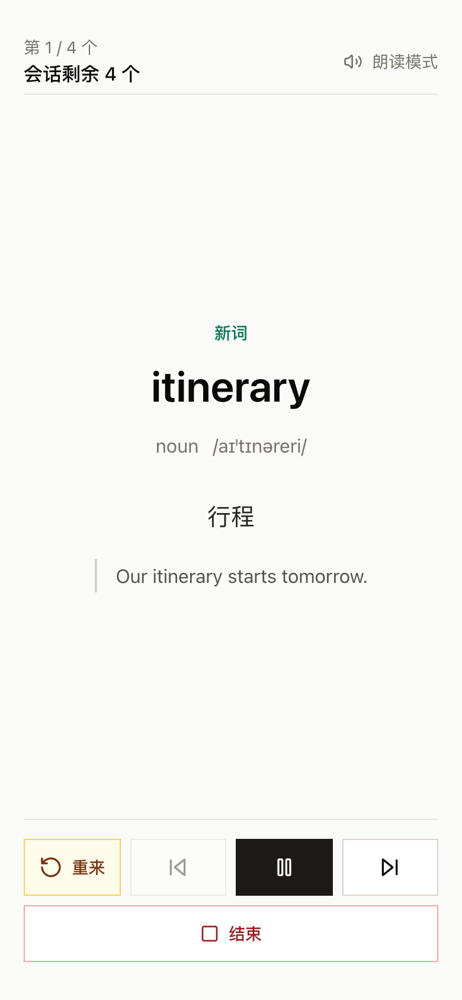
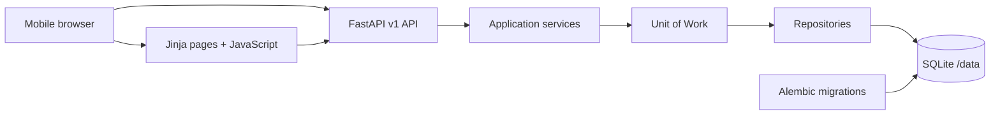

# WordStream

WordStream (单词流) is a mobile-first vocabulary read-along PWA. It imports
words and phrases, builds review-first study queues, reads entries with the
browser speech API, records binary Leitner outcomes, and reports timezone-aware
daily progress.



## Architecture



WordStream is a modular monolith. Services own transaction boundaries,
repositories contain persistence queries, and Alembic exclusively owns schema
evolution. See [architecture](docs/architecture.md) and
[architecture decisions](docs/adr/).

## Requirements

- Python 3.11 or 3.12
- `curl` for the pinned Tailwind standalone CLI
- Playwright Chromium for browser tests

Node.js is not required.

## Local Setup

```bash
python3.12 -m venv .venv
source .venv/bin/activate
python -m pip install -e ".[dev]"
python -m playwright install chromium
cp .env.example .env
./scripts/build_css.sh
alembic upgrade head
uvicorn app.main:app --reload
```

Open `http://127.0.0.1:8000/`. A healthy installation returns database status
`ok` and migration status `current`:

```bash
curl http://127.0.0.1:8000/api/v1/health
```

Local development defaults to `AUTH_MODE=disabled`. For the password gate, set
`AUTH_MODE=password`, `APP_PASSWORD`, and `SECRET_KEY`.

## Main Workflow

1. Open `/vocabularies/import` and paste delimited text or upload CSV/TSV.
2. Preview and confirm the import.
3. Configure the vocabulary's daily new/review limits and playback interval.
4. Start the read-along player and record `seen` or `again`.
5. Open `/statistics` to inspect today's learned terms, due reviews, streak,
   and current entry count.

See the [demo walkthrough](docs/demo.md) for a sample dataset.

## Tests

```bash
ruff check .
black --check .
mypy app
pytest tests/unit tests/repository tests/integration
coverage report --include="app/services/*" --fail-under=80
pytest tests/e2e --no-cov
alembic check
```

The normal pytest configuration enforces at least 80% branch coverage for the
application. CI separately enforces 80% coverage for core services. E2E tests
run without coverage because they exercise the application in another process.

On macOS, system Chrome can be selected when bundled Playwright Chromium cannot
start:

```bash
RUN_SYSTEM_CHROME_E2E=1 pytest tests/e2e --no-cov
```

## Docker

```bash
docker build -t wordstream .
docker volume create wordstream-data
docker run -d --name wordstream -p 8000:8000 \
  -v wordstream-data:/data \
  -e ENVIRONMENT=production \
  -e AUTH_MODE=password \
  -e APP_PASSWORD='replace-me' \
  -e SECRET_KEY='replace-with-a-long-random-value' \
  -e APP_TIMEZONE=Asia/Shanghai \
  -e DATABASE_URL=sqlite:////data/wordstream.db \
  wordstream
```

The container upgrades the mounted database before starting one Uvicorn worker.
SQLite deployments must remain single-instance unless the persistence design is
changed.

## Deployment

Render and Fly.io both use the same container and persistent `/data` volume.
`render.yaml` is ready to create a Render service. Copy `fly.toml.example` to
`fly.toml`, choose a unique app name, create the volume, and set secrets.

Detailed commands, backup/restore procedures, and platform tradeoffs are in
[deployment](docs/deployment.md).

## API

Interactive OpenAPI documentation is available at `/docs`. Copyable examples
for authentication, imports, plans, study outcomes, statistics, and deletion
are in [API examples](docs/api-examples.md).

## Documentation

- [Architecture](docs/architecture.md)
- [API examples](docs/api-examples.md)
- [Deployment and backups](docs/deployment.md)
- [Demo walkthrough](docs/demo.md)
- [Architecture decision records](docs/adr/)
