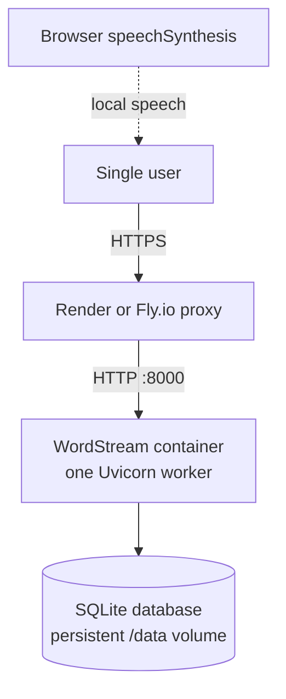
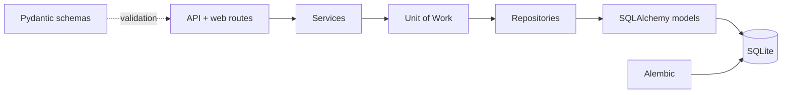
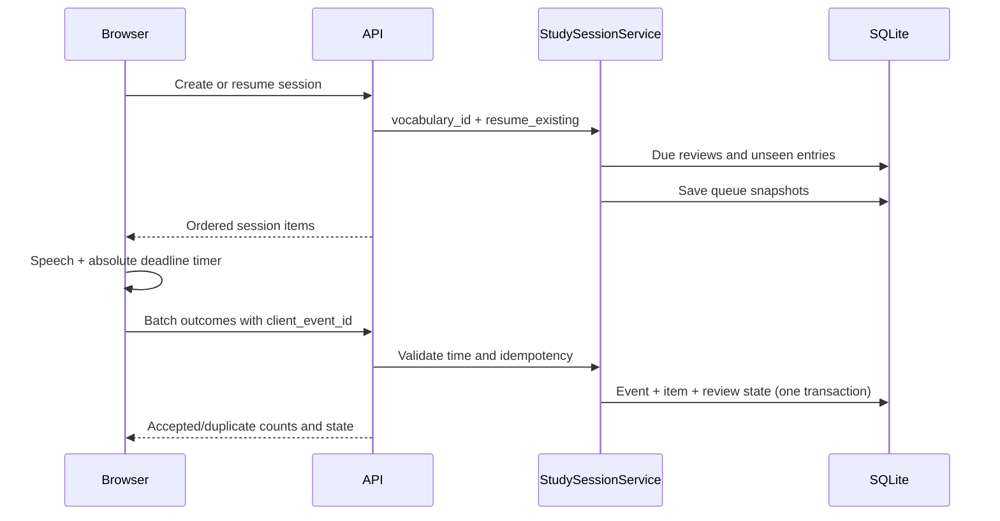

# WordStream Architecture

## System Context

WordStream is a single-user, mobile-first FastAPI application. Server-rendered
Jinja pages and small JavaScript modules provide the UI; the same process serves
the JSON API and static PWA shell. SQLite is the only stateful dependency.

HTTPS terminates at the platform. The application container and volume must run
as one instance because SQLite does not provide distributed write coordination.

## Application Layers

- `api`: request validation, authentication, status codes, and response models.
- `web`: Jinja pages and static PWA resources.
- `services`: use cases, business rules, and transaction ownership.
- `repositories`: SQL queries, adds, and flushes without commits.
- `models`: SQLAlchemy persistence models.
- `schemas`: Pydantic API contracts.
- `utils`: framework-light shared helpers.

A service opens a Unit of Work and commits one complete use case. Exceptions
roll back when the Unit of Work exits. Application startup never calls
`create_all`; the container entrypoint runs `alembic upgrade head`.

## Study Flow

The queue always places due reviews before new entries. Random mode shuffles
within each group only. `again` returns review state to box 0; `seen` advances
one box. The browser stores unconfirmed batches in local storage and retries
them after network recovery.

## Historical and Live Data

Learning events are append-only facts containing term, vocabulary, timezone,
and local activity-date snapshots. Vocabulary deletion cascades to entries,
plans, sessions, and review state while setting the event's `entry_id` to null.
Historical learned counts and streaks therefore survive deletion; current due
review and entry counts do not.

## Security Boundary

Production requires shared-password authentication and a signing key.
Browser sessions use signed, HTTP-only, SameSite=Lax, Secure cookies.
Cookie-authenticated writes require a CSRF header. An optional API key supports
automation. No CORS middleware is installed, so cross-origin callers receive no
permission headers. Secrets and imported content are excluded from application
logs.

## Time and Scheduling

All event instants are accepted and compared in UTC. At write time, the current
IANA application timezone is stored with the derived local `activity_date`.
Changing the timezone affects future events only. Player advancement uses an
absolute deadline so a backgrounded mobile page advances at most once when it
becomes visible again.

## Verification Boundaries

- Unit tests cover parsers, queue rules, Leitner transitions, timing, and
  statistics.
- Repository tests run SQL against migrated temporary SQLite files.
- Integration tests cover API behavior, auth, CSRF, rollback, migrations,
  idempotency, and lock conflicts.
- Playwright tests use a 390x844 viewport and exercise import, planning,
  playback, persistence, speech failures, background timing, and statistics.
- CI builds and restarts the production Docker image with a named volume.
